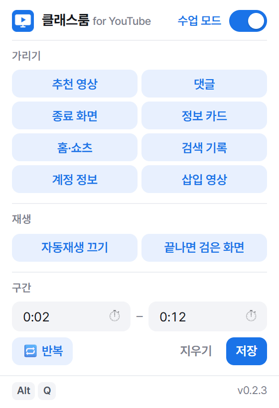
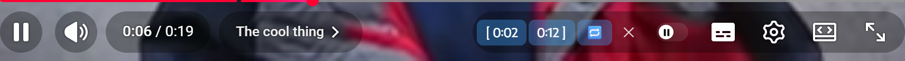
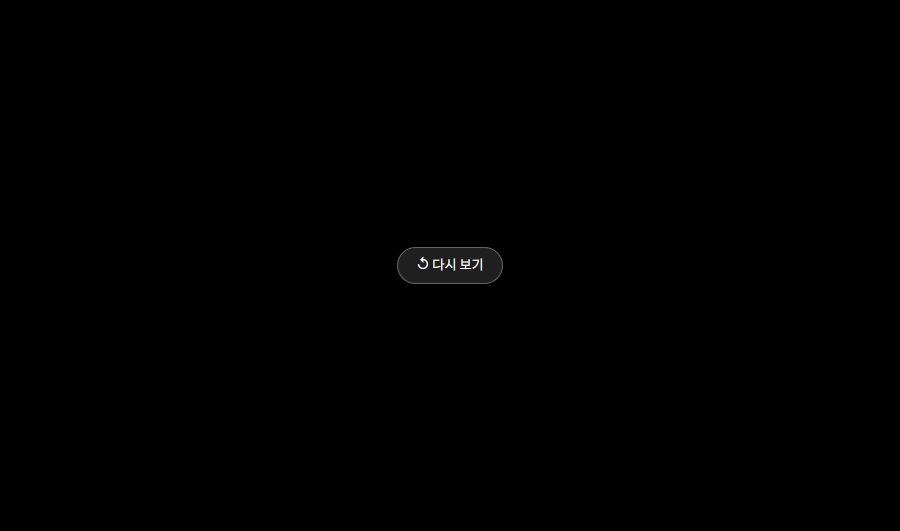

# 클래스룸 for YouTube

교실 TV로 유튜브를 틀 때 생기는 사고를 막는 크롬·웨일·엣지 확장입니다.

- 오른쪽 추천 영상, 댓글, 영상 끝 추천 화면, 정보 카드를 가립니다.
- 홈 추천·쇼츠, 검색어 자동완성(이전 검색어), 계정 아이콘·구독·시청 기록을 가립니다.
- **패들렛·학급 홈페이지 등에 넣은 영상(임베드)** 에서도 일시정지 추천과 종료 화면을 가립니다.
- 영상이 끝나면 **검은 화면**으로 멈추고 "다시 보기" 버튼만 보여줍니다.
- **구간 재생**: 영상마다 시작·끝 지점을 저장해, 필요한 부분만 재생하고 끝에서 멈춥니다. **반복**을 켜면 그 구간(끝이 없으면 영상 전체)을 계속 반복합니다.
- 광고는 건드리지 않습니다.

## 화면

<table>
<tr>
<td width="290" valign="top"></td>
<td valign="top">

**팝업** (툴바 아이콘 클릭)
- 맨 위 스위치로 수업 모드 켜기/끄기 (`Alt+Q`)
- 파란 칩 = 가리는 중. 눌러서 항목별로 켜고 끔
- 유튜브 영상 화면에서 열면 **구간** 칸이 나타남

</td>
</tr>
</table>

**플레이어 버튼**: 영상 아래 컨트롤 바에 구간 버튼이 붙습니다.



`[ 0:02` 시작 지점 · `0:12 ]` 끝 지점 · `🔁` 반복 · `✕` 구간 삭제 — 지정된 버튼은 파랗게 표시됩니다.

**검은 화면**: 영상이나 구간이 끝나면 추천 영상 대신 이 화면이 뜹니다.



## 이렇게 씁니다

**① 사회 시간: 긴 영상에서 필요한 3분만**
1. 영상을 2:10까지 넘기고 `[ 시작` 클릭
2. 5:10까지 넘기고 `끝 ]` 클릭
3. 수업 때 영상을 열면 2:10부터 시작 → 5:10에서 검은 화면으로 멈춤

**② 음악 시간: 후렴 반복 연습**
1. 후렴 앞뒤로 `[ 시작` · `끝 ]` 지정
2. `🔁` 클릭 → 그 구간만 계속 반복
3. 끝나면 `🔁`를 한 번 더 눌러 반복 끄기

**③ 패들렛·학급 홈페이지에 넣은 영상**
- 따로 할 일 없음. 일시정지하거나 끝나도 다른 영상 추천이 뜨지 않습니다.

**④ 쉬는 시간에 개인적으로 볼 때**
- `Alt+Q`로 수업 모드 끄기 → 유튜브가 원래대로 보임. 수업 전에 다시 `Alt+Q`.

> 구간은 영상마다 따로 저장됩니다. 수업 전날 미리 지정해 두면 다음 날 그대로 재생됩니다.

## 다운로드

**[⬇ 최신 버전 받기 (youtube-classroom.zip)](https://github.com/bin7335/youtube-classroom/releases/latest/download/youtube-classroom.zip)**

이 링크는 항상 최신 버전을 가리킵니다. 지난 버전은 [Releases](https://github.com/bin7335/youtube-classroom/releases)에 있습니다.

## 설치 (개발자 모드, 3분)

1. 받은 `youtube-classroom.zip`을 오른쪽 클릭 → **압축 풀기**. 생긴 폴더는 지우지 말고 보관합니다.
2. 주소창에 `chrome://extensions` 입력 (웨일: `whale://extensions`, 엣지: `edge://extensions`).
3. 오른쪽 위 **개발자 모드** 켜기.
4. **압축해제된 확장 프로그램을 로드합니다** → `manifest.json`이 있는 폴더 선택.
5. 툴바 퍼즐 아이콘에서 클래스룸 for YouTube를 **고정**합니다.

## 사용법

| 하고 싶은 것 | 방법 |
|---|---|
| 수업 모드 켜기/끄기 | 툴바 아이콘 → 스위치, 또는 `Alt+Q` |
| 가릴 항목 고르기 | 툴바 아이콘 → 체크박스 |
| 구간 지정 | 플레이어 아래쪽 **[ 시작** · **끝 ]** 버튼 (지금 위치 저장), 또는 팝업에서 `2:10` 처럼 입력 |
| 구간 반복 | 플레이어의 **🔁** 버튼 또는 팝업의 반복 체크 (노래·받아쓰기 연습용) |
| 구간 지우기 | 플레이어의 **✕** 버튼 또는 팝업의 **지우기** |

- 수업 모드는 설치하면 **켜진 상태**로 시작합니다. 아이콘에 `ON` 배지가 보이면 켜진 것입니다.
- 설정은 브라우저 계정 동기화로 다른 PC에도 적용됩니다. 구간은 그 PC에만 저장됩니다.
- 단축키는 `chrome://extensions/shortcuts` 에서 바꿀 수 있습니다. (크롬 정책상 `Ctrl` 또는 `Alt` 조합만 가능)
- 이전 버전(`Alt+Shift+Y`)을 쓰던 경우: 확장을 **삭제 후 다시 로드**하거나 위 페이지에서 `Alt+Q`로 바꿔야 적용됩니다.

## 개인정보

어떤 데이터도 외부로 보내지 않습니다. 설정과 구간 정보는 브라우저 저장소(`chrome.storage`)에만 저장됩니다.
권한은 `storage` 하나이며, 유튜브(`youtube.com`, `youtube-nocookie.com`) 페이지에서만 동작합니다.

## 개발

```bash
npm install
npm test          # 설정·시간 계산 단위 테스트
npm run smoke     # 실제 유튜브에 확장을 올려 확인 (인터넷 필요)
npm run pack      # dist/ 에 배포용 zip 생성
node tools/screenshots.mjs   # README 화면 캡처 갱신 (docs/)
```

- Playwright Chromium 실행이 보안 정책으로 막힌 PC는 `SMOKE_CHANNEL=msedge npm run smoke` 로 설치된 엣지를 씁니다.
- 유튜브 화면 구조가 바뀌어 무언가 다시 보이면 `src/content/content.css` 의 선택자를 고치면 됩니다.

| 파일 | 역할 |
|---|---|
| `src/shared/settings.js` | 기본값, 설정 병합, 시간·구간 계산 (테스트 대상) |
| `src/content/content.css` | 숨김 규칙 (`<html>` 클래스 기준) |
| `src/content/content.js` | 클래스 적용, 자동재생 끄기, 검은 화면, 구간 재생 |
| `src/popup/` | 툴바 팝업 |
| `src/background.js` | 단축키, `ON` 배지 |

## 상표

YouTube는 Google LLC의 상표입니다. 이 확장은 Google·YouTube와 관련이 없는 비공식 도구입니다.

## 라이선스

MIT
